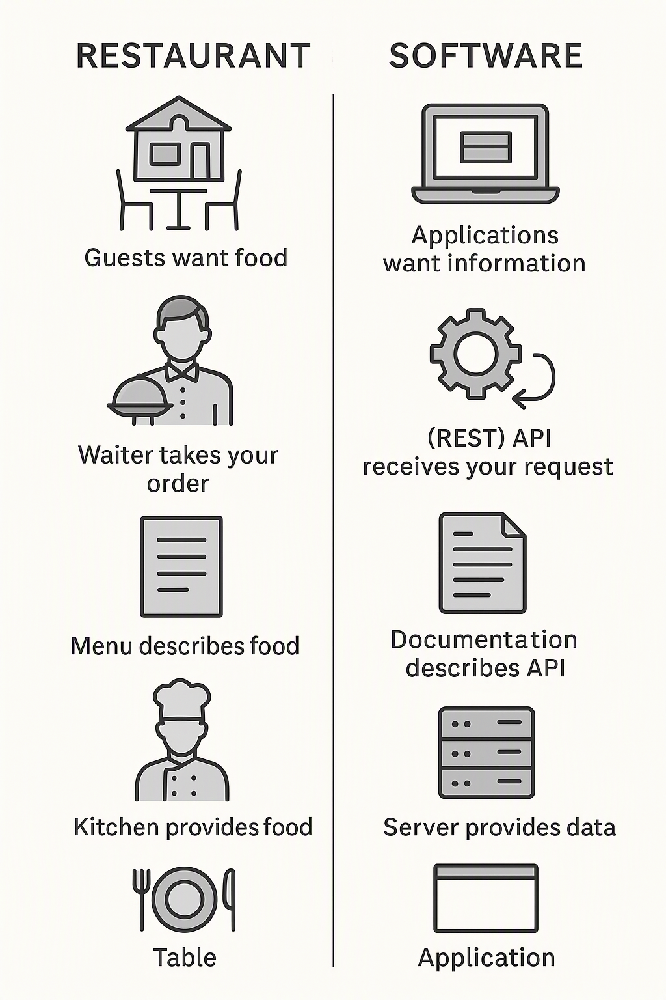
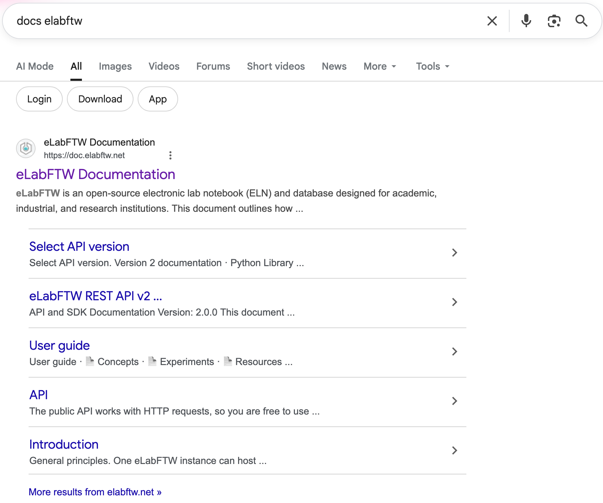

:::::::::::::::::::::::::::::::::::::: questions

- What is a (REST) API?
- What can I do with the eLabFTW API
- Where can I find help on the eLabFTW API
- How can I write and API call?
- How can I view the response?

::::::::::::::::::::::::::::::::::::::::::::::::

::::::::::::::::::::::::::::::::::::: objectives

- explain what a (REST) API is (in very basic terms)
- explain what they can do with the eLabFTW API
- find help on the eLabFTW API
- formulate the API URL for a given eLabFTW instance
- make a basic eLabFTW API call using the browser
- interpret eLabFTW API responses

::::::::::::::::::::::::::::::::::::::::::::::::

## Introduction to APIs

In this course, we will be using the eLabFTW API to interact with the ELN. First, though, let's take a step back and clarify what APIs are.

API is short for **application programming interface**. You may also see the term REST or RESTful API, which indicates that an API conforms to design principles of the representational state transfer (REST) architectural style.

> An API, or application programming interface, is a set of rules or protocols that enables software applications to communicate with each other to exchange data, features and functionality. (<https://www.ibm.com/think/topics/api>)

A (REST) API is, simply put, something that allows you to (programmatically) interface an application.

Let's use an analogy from the real world: a restaurant.

{alt='AI generated image comparing a software to a restaurant, in which APIs are like waiters.'}

**Restaurant | Software:**

- In a restaurant, the guests want food, which the kitchen can provide.
- In a software system, one application wants information that another can provide.

**Waiter | API:**

- In a restaurant, the waiter takes your order to the kitchen and brings back your food.
- In software, the API receives your request and provides the appropriate response.

**Menu | Documentation:**

- In a restaurant, there is a menu that describes which food is available at which cost.
- In software, the documentation describes what the API can provide and how.

**Kitchen | Server:**

- In a restaurant, there is the kitchen with its staff to provide food for guests.
- In software, the server and its processes provide data to users.

**Table | Application:**

- In a restaurant, the guests sit at the table to interact with the food from the kitchen they get from the waiter.
- In software, the user uses an application to work with data from a server provided by its API.

## The eLabFTW API

eLabFTW's API let's you interact with the ELN, e.g., retrieve and write information from it, without using the graphical user interface (GUI). This is something you may want to do to create automated workflows and avoid repetitive work.

Sticking with our restaurant analogy, we first need to figure out what is available to us, in programmatic terms: what requests we may make (or in restaurant terms: what orders we may place).

To this end, we head to the menu, or in the API's case, the documentation, or short [docs](https://doc.elabftw.net/docs/usage/api/):

This gives us very basic information on the API. If we scroll down we find another link to the [full documentation](https://doc.elabftw.net/api/).

Three things are important for this course: (1) the version 2 documentation link, which leads to the APIs [Swagger documentation page](https://doc.elabftw.net/api/v2), (2) the [HTML doc (v2)](https://doc.elabftw.net/api/elabapi-html/) and (3) the [Python Library (v2) link](https://github.com/elabftw/elabapi-python), the latter two of which we will get to later.

Let's head to the [Swagger page]((https://doc.elabftw.net/api/v2)). Here, we have a list of **endpoints**, sub-divided into categories. Each link is color-coded to indicate the type of request, further marked by `PUT`, `POST`, `GET`, `PATCH`, and `DELETE` labels.

Scrolling through the categories and knowing how eLabFTW is structured, we can get a pretty good idea of the types of interaction we can carry out. For instance, under `Experiment Categories` we have a `GET` request that let's us read all experiment categories in a given team (indicated by it's ID).

## Constructing Requests

The first time you see these types of docs pages, it may seem a bit daunting. So let's construct our first API call using a tool we're all familiar with: our browser.

1. Write the eLabFTW URL, e.g., `https://elab.parks.web.gateway.ionos.coscine.dev` or `https://research.eln.rwth-aachen.de` in the menu bar.
2. Add `/api/v2`.
3. Add `/users/me`, behind this (hint: for more complicated endpoints, copy and paste from docs by hovering over the endpoint and using the clipboard icon).
4. You show now have something that looks `http://elab.parks.web.gateway.ionos.coscine.dev/api/v2/users/me`.
5. Hit <kbd>return</kbd>.

If you are _not_ logged in, you will get a `401` error since you are not authorized to view this information. Log in to eLabFTW, then refresh the page.

::::::::::::::::::::::::::::::::::::: challenge

## Find your User ID

What is _your_ user ID? Find it and note for later. Ensure you have requested the ID from the instance you will be working with in this course.

:::::::::::::::::::::::: solution

## Solution

The top line has the `userid` attribute, which is your user ID. You can also use the browser's search function to find it: <kbd>ctrl</kbd>+<kbd>f</kbd> &rarr; type 'userid'.

:::::::::::::::::::::::::::::::::
::::::::::::::::::::::::::::::::::::::::::::::::

Requests typically return JSON. Depending on which browser you are using, it may be rendered nicely for better readability. Understanding the structure can greatly help when you are trying to find a specific piece of information. What helpful is knowing which key the value you are looking for belongs to. `userid` was the key in our example.

We can also see a nested structure when we look at the `teams` key, with more keys provided for each team listed.

::::::::::::::::::::::::::::::::::::: keypoints

- An API lets us interact with software in a programmatic manner
- The APIs docs let us know which requests we may make
- We can use the browser to make requests and view the response

::::::::::::::::::::::::::::::::::::::::::::::::

## Attribution

The API-Restaurant analogy of this lesson was adapted from [Torsten Giess](https://github.com/torogi94) ( [0000-0002-8512-8606](https://orcid.org/0000-0002-8512-8606)), from the University of Bielefeld (formerly University of Stuttgart).
