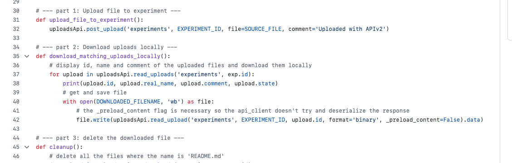

:::::::::::::::::::::::::::::::::::::: questions

- How can I upload files attached to entries in eLabFTW?
- How can I create a quick plot in Python?
- How can I add images to my eLabFTW entries?

::::::::::::::::::::::::::::::::::::::::::::::::

## Data Analysis Workflows

Let's imagine we had used an automated workflow in episode 04 to create the files. Everything ran in our absence and we have the individual output files attached to the experiments.

We can now keep going and add some more information to our experiments, such as a plot to quickly see the data, for example:

<!-- ```mermaid
---
config:
  layout: dagre
---
flowchart LR
 subgraph s4["ELN (GUI)"]
        n3["Experiment"]
        n11["measurement file"]
  end
 subgraph s3["Jupyter Notebook"]
        n10["get measurement files from experiment"]
        n5["create plots"]
  end
 subgraph s2["Your Computer"]
        s3
  end

    n5 -- attach --> n3
    n3 --> n11
    n10 --> n5
    n11 --> n10

``` -->

We have not worked with Pandas or Matplotlib yet, but they are the most common Python libraries for data analysis and visualization. We will use them to load the CSV file and create a plot.

Also note, we use aliases for certain libraries to make the code more concise. This is a common practice in Python, especially for frequently used libraries. `pd` is the standard alias for `pandas`.

Since we're in a new notebook, we set everything up by importing the package and creating the API clients we need:

```python
import elabapi_python
experiments_api = elabapi_python.ExperimentsApi(api_client)
uploads_api = elabapi_python.UploadsApi(api_client)
```

Let's access one of our experiments and download the data file.

We will continue to use the `uploads_api` to interact with attached files. To ensure we have our experiment information, let's retrieve these again. We will filter by status again, but remember, we changed this to _Running_. The GUI reminds us that this status has ID 47.

```python
heating_experiments = experiments_api.read_experiments(q='Heating', status = 47, scope=1)

```

Let's work with a single experiment and retrieve the data file. This is where we need the ID from the retrieved experiments. We will work with the first one in our list.

Check out the example in [examples/03-experiment-file-handling.py](https://github.com/elabftw/elabapi-python/blob/master/examples/03-experiment-file-handling.py).



That gives us a function to work with. Let's copy and paste and then modify slightly:

```python
experiment = heating_experiments[0]

def download_matching_uploads_locally(exp): # added experiment
    # display id, name and comment of the uploaded files and download them locally
    for upload in uploads_api.read_uploads('experiments', exp.id): # match uploads_api spelling
        print(upload.id, upload.real_name, upload.comment, upload.state)
        # get and save file
        with open(upload.real_name, 'wb') as file: # edited file name variable to match real name
            # the _preload_content flag is necessary so the api_client doesn't try and deserialize the response
            file.write(uploads_api.read_upload('experiments', exp.id, upload.id, format='binary', _preload_content=False).data) # edited exp.id, match uploads_api spelling 
```

This will download all files attached to the specified experiment. It does this by looping over the uploads, then using the uploads_api to read the file and write the file.

After running the cell we can use the function.

To call the it we write the name of the function, followed by parentheses, in which we pass the experiment in question:

```python
download_matching_uploads_locally(experiment)
```

If we check our workspace, we can see the file has been downloaded.

::::::::::::::::::::::::::::::::::::: callout

The `_preload_content=False` argument is needed by this generated client when
downloading file content. Without `format="binary"`, the request returns upload information rather than the file itself.

::::::::::::::::::::::::::::::::::::::::::::::::

## Visualize the Data

Using pandas, we can easily read in and plot the data. First we import pandas. Again, We use the alias `pd` here, which is the standard way to import pandas. We read the CSV by file name using the `read_csv` method. Then, we can use `head` to view the first few lines of the dataframe.

```python
%pip install pandas # if needed
import pandas as pd

measurement_data = pd.read_csv("50_measurement_2026-11-05T11:27:07.281399.csv")
measurement_data.head()
```

Now, let's create a quick plot. Pandas uses the package matplotlib to do this in a built-in manner.

```python
measurement_data.plot.scatter(x='time_s', y='temperature_C')
```

This is very basic. Let's add a title. We can also save he figure to a variable so we can keep working with it. In this case we want to save.

```python
ax = measurement_data.plot.scatter(x='time_s', y='temperature_C', title = 'Laser Power 50 W')
```

We now have the plot with the title. You can make all kinds of changes here, from axis labels to colors, but for a quick overview, it's sufficient. Let's save it.

```python
ax.figure.savefig("50w_temp_time_plot.png", dpi=300)
```

Attach to the experiment:

```python
uploads_api.post_upload('experiments', experiment.id, file="50w_temp_time_plot.png")
```

::::::::::::::::::::::::::::::::::::: challenge

Use the above snippets and function to write a code that

1. Retrieves all run experiments
2. Plots and saves figures for each
3. Attaches the plot back to the experiment
4. Sets the experiment status to success

Hint: make a small modification to the `download_matching_uploads_locally` so you can retrieve the file name.

**Bonus:** If anyone can figure out how to add an image directly to the main text field using the API, please share!

::::::::::::::::::::::::::::::::::::: solution

Here is one possible solution. This assumes you start with a new notebook or write a Python script, so it includes all data imports and retrieves the experiment information.

```python
import pandas as pd
import elabapi_python


def download_matching_uploads_locally(exp): 
    downloaded_file_names = [] # initialize empty list to collect file names
    for upload in uploads_api.read_uploads('experiments', exp.id): 
        print(upload.id, upload.real_name, upload.comment, upload.state)
        with open(upload.real_name, 'wb') as file: 
            file.write(uploads_api.read_upload('experiments', exp.id, upload.id, format='binary', _preload_content=False).data) 
        downloaded_file_names.append(upload.real_name) # add file name to list once downloaded
    return downloaded_file_names #return file name so we can access outside of function


heating_experiments = experiments_api.read_experiments(q='Heating', status = 47, scope=1) # retrieve experiment information with filters applied

for experiment in heating_experiments: # loop over each heating experiment in our list
    downloaded_file_names = download_matching_uploads_locally(experiment) # will download all files for each experiment we pass
    for file_name in downloaded_file_names: # loop over downloaded files

        if file_name.endswith('csv'): #make sure you're not trying to load some other type of file
            measurement_data = pd.read_csv(file_name) # load into dataframe
            power = file_name.split('_')[0] # get power setting from file name
            title = f"Laser Power {power} W" # dynamically set plot title
            ax = measurement_data.plot.scatter(x='time_s', y='temperature_C', title = title) # create plot
            figure_name = f"{power}w_temp_time_plot.png" # dynamically set figure name 
            ax.figure.savefig(figure_name, dpi=300) # save figure
            uploads_api.post_upload('experiments', experiment.id, file=figure_name) # upload figure file

```

:::::::::::::::::::::::::::::::::::::

::::::::::::::::::::::::::::::::::::::::::::::::

::::::::::::::::::::::::::::::::::::: instructor

The following challenge is for playtime if time permits. Alternative would be to ask if learners want to see something specific.

::::::::::::::::::::::::::::::::::::::::::::::::

::::::::::::::::::::::::::::::::::::: challenge

This is play time. Below are ideas of things you can try out. The solution provides hints rather than actual solutions for each point.

- Change permissions on your create experiments
- Book a device
- Export entries in different formats
- Create individual resources from a CSV (where each row represents a resource)

::::::::::::::::::::::::::::::::::::: solution

Hints and places to start:

- Change permissions on your create experiments: [examples/14-fix-user-exp-permissions.py](https://github.com/elabftw/elabapi-python/blob/master/examples/14-fix-user-exp-permissions.py)
- Book a resource: [examples/13-events.py](https://github.com/elabftw/elabapi-python/blob/master/examples/13-events.py), [doc.elabftw.net/api/elabapi-html/#api-Events-postEvents](https://doc.elabftw.net/api/elabapi-html/#api-Events-postEvents)
- Export entries in different formats

    For ELN files:

    ```python
    def download_eln_archive(
        experiment_id: int,
        download_folder: Path = Path("eln_downloads")
    ):
        """
        Download an experiment's ELN archive and save it to the specified folder.
        """
        # ensure the download folder exists
        download_folder.mkdir(parents=True, exist_ok=True)

        eln_file_path = download_folder / Path(f"{experiment_id}-export.eln")

        try:
            with open(eln_file_path, "wb") as file:
                response = experimentsApi.get_experiment(
                    experiment_id, format="eln", _preload_content=False
                )
                file.write(response.data)
            logger.info(
                f"Downloaded ELN archive for experiment {experiment_id} to {eln_file_path}"
            )
            return eln_file_path
        except Exception as e:
            logger.error(
                f"Failed to download ELN archive for experiment {experiment_id}: {e}"
            )
            raise
    ```

 Create individual resources from a CSV (where each row represents a resource) [examples/09-import-csv.py](https://github.com/elabftw/elabapi-python/blob/master/examples/09-import-csv.py)

If you would like to contribute your solutions, please don't hesitate to do so. We can include them here for future courses.
:::::::::::::::::::::::::::::::::::::

::::::::::::::::::::::::::::::::::::::::::::::::


::::::::::::::::::::::::::::::::::::: keypoints

- The eLabFTW Python API client allows you to retrieve all or specific files attached to an experiment
- Pandas can turn downloaded CSV data into a table ready for analysis
- Pandas has built-in matplotlib to visualize data and save plots

:::::::::::::::::::::::::::::::::::::::::::::::
