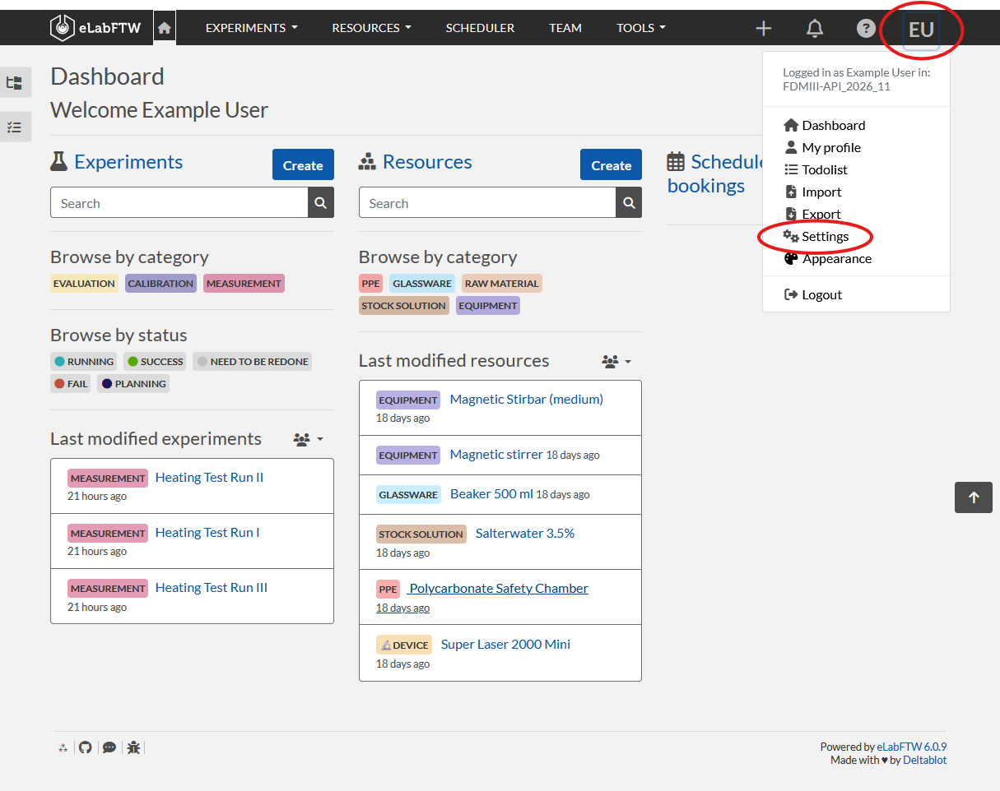
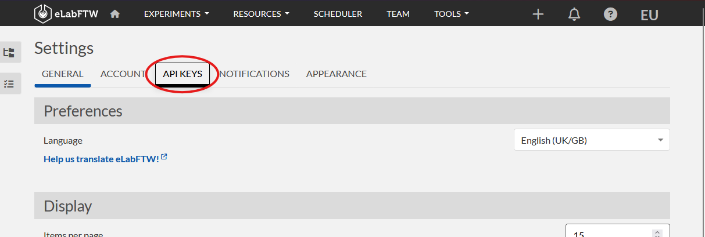
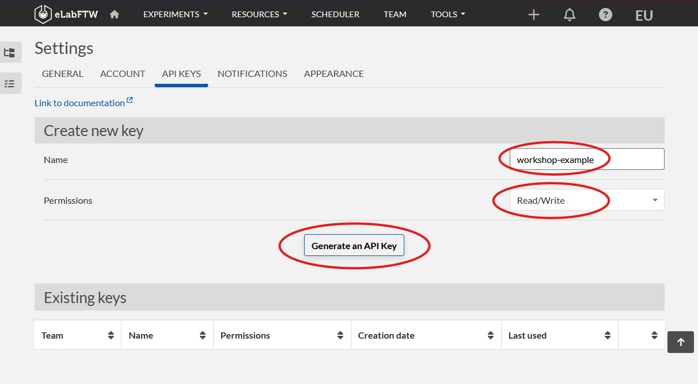

:::::::::::::::::::::::::::::::::::::: questions

* What tools aside from the browser can I use to make API requests?
* How can I authenticate myself?

::::::::::::::::::::::::::::::::::::::::::::::::

::::::::::::::::::::::::::::::::::::: objectives

* Create an API token in the eLabFTW GUI
* Make a basic call to the eLabFTW API using the command line and curl
* Make user-specific API calls using the command line and curl and the API token

::::::::::::::::::::::::::::::::::::::::::::::::

## Command-Line Interface

Using our browser isn't exactly useful when we want to automate workflows.

A useful, built-in tool is a command-line interface, terminal, prompt, shell, and so on. The terminology is rather specific to operating system and often used interchangeably. We're going to use terminal in the remainder of this course.

<!--Open one on your system:

**Mac**

  1. <kbd>command</kbd>+<kbd>spacebar</kbd> to open the search window
  2. type `terminal`
  3. <kbd>return</kbd>

**Windows**

   1. <kbd>windows</kbd> to open the menu
   2. type `cmd`
   3. select cmd to open

**Linux**

1. <kbd>ctrl</kbd>+<kbd>alt</kbd>+<kbd>t</kbd> is the default terminal shortcut for most distributions

    Alternatively:
   1. Search `shell` in your launcher
   2. click the terminal result to open.
-->

Open a new terminal in Jupyter Lab. (_Hint: if you already have a window open, use the blue `+` button in the top left corner of the Jupyter Lab window to open a new launcher. Then click the terminal icon._)

We will use a tool called [`cURL`](https://curl.se/) to make API calls. This is a typical tool used for data transfer.

We could head to its documentation to learn how to use it, but let's be lazy and use what we already have, e.g., the usage examples in the [HTML doc (v2)](https://doc.elabftw.net/api/elabapi-html/) we just saw.

Sticking to Users, let's replicate what we did in our browser as a cURL request. You can try to construct this in your terminal, but for many of us it is easier in a text editor. Copy and paste the cURL code.

Unlike our browser, through which we have been identified by logging in, we now need to tell the ELN we are allowed to have access. This is done by creating a token:

1. Head your eLabFTW instance
2. click your initials on the top right-hand side
3. click `settings`

1. Select the `API KEYS` header

2. Under `Create new key`, enter a name for your key and select `Read/Write` from the permissions drop-down menu.
3. click `Generate an API Key`

4. Copy and paste this to the `secrets.env` file in your `research_computer/` folder for later use. It will only be shown once in the ELN's GUI!

Now we can start editing the request:

1. Paste your token, replacing `[[apiKey]]`
2. Replace `https://elab.local:3148` with your eLabFTW URL
3. Replace {id} with `me`
4. Put spaces before the `/`

::::::::::::::::::::::::::::::::::::: caution

The cURL examples in the HTML Docs page are missing a white space before the backslashes (`/`). Whenever you copy-and-paste from here, you will have to add them.

:::::::::::::::::::::::::::::::::::::::::::::

If you are working in the a text editor, copy this code into your terminal. Now, we will execute by hitting <kbd>enter</kbd>.

::::::::::::::::::::::::::::::::::::: callout

You can type this info directly into your terminal. For larger requests, however, especially when just starting out, it can be difficult to navigate. Thus, copy and pasting from a text editor may be easier and it is easier to catch problems.

::::::::::::::::::::::::::::::::::::::::::::::::

::::::::::::::::::::::::::::::::::::: callout

You can load the API key from a `secrets.env` file instead of pasting the secret into the command.

Create such a file **in the workshop directory** and paste your token:

```bash
ELAB_API_KEY='YOUR_TOKEN_HERE'
ELAB_API_HOST='https://elab.parks.web.gateway.ionos.coscine.dev/api/v2'
```

From the **workshop directory**, run:

```bash
set -a
source research_computer/secrets.env
set +a
```

The `secrets.env` file should contain `ELAB_API_KEY` and `ELAB_API_HOST`. The key is
then available as the `$ELAB_API_KEY` environment variable. Use it in the request like this:

```bash
curl -i -X POST \
   -H "Authorization: $ELAB_API_KEY" \
   -H "Accept: application/json" \
   -H "Content-Type: application/json" \
   -d '{"title":"my api exp"}' \
   "$ELAB_API_HOST/experiments"
```

This keeps the token out of the command itself. Do not print the variable or share the `secrets.env` file. If you believe you unsafely used an API key, always revoke it and create a new one.

Note: `.env` is more common, however, Jupyter lab immediately hides these.

::::::::::::::::::::::::::::::::::::::::::::::::

Now, let's make a new request and create an experiment:

Scroll to the [Experiments](https://doc.elabftw.net/api/elabapi-html/#api-Experiments) section on the left and click [`postExperiment`](https://doc.elabftw.net/api/elabapi-html/#api-Experiments-postExperiment). Again, we will look at the cURL usage example and copy and paste it into our text editor. Similar to the steps above:

1. Copy and paste your token to the terminal, replacing `[[apiKey]]`
2. Replace `https://elab.local:3148` with your eLabFTW URL
3. Add experiment info using the template below. Once done, add `\` at the end of the last line, <kbd>enter</kbd> for a new line and add `-d '{"title":"my api exp"}` (replace info in curly brackets with the full data)
4. Add `-i` before `-X` in the top line. This ensures the response is output.
5. Copy and paste into your terminal
6. Hit <kbd>enter</kbd> to run

Note: Don't forget to add spaces between the `\` and the end of the line.

Template for data:

_Feel free to modify!_

```json
{
   "title": "Temperature calibration",
   "body": "<p>Calibration check for the temperature sensor before the measurement run.</p><p>Expected range: 20-25 degrees C.</p>",
   "canread_base": 30,
   "canwrite_base": 20,
   "canread": "{\"teams\": [], \"users\": [], \"teamgroups\": []}",
   "canwrite": "{\"teams\": [], \"users\": [], \"teamgroups\": []}",
   "category": 27,
   "metadata": {
      "extra_fields": {
         "sample_id": {
            "type": "text",
            "value": "TC-2026-001"
         },
         "instrument": {
            "type": "text",
            "value": "Omega HH506RA"
         },
         "run_number": {
            "type": "number",
            "value": 1
         },
         "target_temperature": {
            "type": "number",
            "value": 22
         },
         "calibration_status": {
            "type": "select",
            "value": "planned"
         }
      }
   }
}
```

Final code:

```bash
curl -i -X POST \
    -H "Authorization: $ELAB_API_KEY" \
    -H "Accept: application/json" \
    -H "Content-Type: application/json" \
    -d '{
   "title": "Temperature calibration",
   "body": "<p>Calibration check for the temperature sensor before the measurement run.</p><p>Expected range: 20-25 degrees C.</p>",
   "canread_base": 30,
   "canwrite_base": 20,
   "canread": "{\"teams\": [], \"users\": [], \"teamgroups\": []}",
   "canwrite": "{\"teams\": [], \"users\": [], \"teamgroups\": []}",
   "category": 27,
   "metadata": {
      "extra_fields": {
         "sample_id": {
            "type": "text",
            "value": "TC-2026-001"
         },
         "instrument": {
            "type": "text",
            "value": "Omega HH506RA"
         },
         "run_number": {
            "type": "number",
            "value": 1
         },
         "target_temperature": {
            "type": "number",
            "value": 22
         },
         "calibration_status": {
            "type": "select",
            "value": "planned"
         }
      }
   }
}' \
   "$ELAB_API_HOST/experiments"
```

::::::::::::::::::::::::::::::::::::: challenge

The below code intends to link the device resource [**Bluetooth Infrared Thermometer**](https://elab.parks.web.gateway.ionos.coscine.dev/database.php?mode=view&id=144) to the experiment experiment created above.

In it current state, it fails. What needs to be fixed?

::: hint

You can use a GET request to the "$ELAB_API_HOST/experiments" endpoint to list all experiments and find the ID of the one you just created.

:::

::: hint

[Read the docs for LinksToExperiments](https://doc.elabftw.net/api/elabapi-html/#api-LinksToExperiments)

:::

```bash
curl -X POST \
   -H "Authorization: $ELAB_API_KEY" \
   -H "Accept: application/json" \
   -H "Content-Type: application/json" \
   "$ELAB_API_HOST/items/144/experiment/{your_exp_id}"
```

:::::::::::::::::::::::: solution

:::::::::::::::::::::::::::::::::

::::::::::::::::::::::::::::::::::::::::::::::::

::::::::::::::::::::::::::::::::::::: challenge

What would the command line `cURL` API call look like that retrieves the experiment we just created? Write and execute this command. Then, analyze the response and see if everything is as you imagined.

::: hint

Look for the `location` in the response from your last call to get the ID.

:::

:::::::::::::::::::::::: solution

The `POST` response includes the URL of the new experiment in its `Location`
header. Copy the experiment ID from that URL, then use it in a `GET` request:

```bash
curl -X GET \
   -H "Authorization: $ELAB_API_KEY" \
   -H "Accept: application/json" \
   "$ELAB_API_HOST/experiments/<EXPERIMENT_ID>"
```

This prints the JSON response directly in the terminal. The response should contain the experiment title and body, its creation and modification details, the permission settings, and the values in `metadata.extra_fields`.

:::::::::::::::::::::::::::::::::

::::::::::::::::::::::::::::::::::::::::::::::::

::::::::::::::::::::::::::::::::::::: callout

**If you have admin rights**, for more readable, indented JSON, you can pipe the response through `jq` :

```bash
curl -sS \
   -H "Authorization: $ELAB_API_KEY" \
   -H "Accept: application/json" \
   "$ELAB_API_HOST/experiments/<EXPERIMENT_ID>" | jq .
```

Here, `|` passes the response to `jq`, and `.` tells `jq` to display the complete JSON document. If `jq` is not installed, install it with one of these commands:

```bash
# macOS with Homebrew
brew install jq

# Debian or Ubuntu
sudo apt install jq

# Windows PowerShell with winget
winget install jqlang.jq
```

On Windows PowerShell, use `curl.exe` rather than `curl` to call cURL
explicitly, because `curl` may be an alias for a PowerShell command (shortened example):

```powershell
curl.exe ... | jq .
```

:::::::::::::::::::::::::::::::::::::::::::::::

<!-- 
::::::::::::::::::::::::::::::::::::: challenge

Fill in the blanks for the the script in `research_computer/attach_measurement.sh` to attach the measurement file (`research_computer/2026_11_17_thermometer_calibration.csv`) to the created experiment.

This is an example of a bash script. There is both a commented and uncommented version. The commented version explains what each line does.

Ensure your `secrets.env` file is set up with your API token and the API host URL and that these have been added to your environment (see callout above),

Run the script with the experiment ID and the measurement file as arguments. For example:

```bash
cd research_computer # change directory
chmod u+x ./attach_measurement.sh # make it executable
./attach_measurement.sh 94 ./measurement.csv # execute it
```

:::::::::::::::::::::::: solution

The [upload endpoint](https://doc.elabftw.net/api/elabapi-html/#api-Uploads-postUpload) expects `multipart/form-data`, so the file must be sent with `-F`. Here' the full code.

```bash
#!/usr/bin/env bash
set -euo pipefail

SCRIPT_DIR="$(cd -- "$(dirname -- "${BASH_SOURCE[0]}")" && pwd)"
ENV_FILE="${ENV_FILE:-$SCRIPT_DIR/.env}"

if [[ -f "$ENV_FILE" ]]; then
      set -a
      source "$ENV_FILE"
      set +a
fi

: "${ELAB_API_HOST:?Set ELAB_API_HOST in $ENV_FILE or the environment}"
: "${ELAB_API_KEY:?Set ELAB_API_KEY in $ENV_FILE or the environment}"

EXPERIMENT_ID="${1:?Usage: $0 EXPERIMENT_ID MEASUREMENT_FILE}"
MEASUREMENT_FILE="${2:?Usage: $0 EXPERIMENT_ID MEASUREMENT_FILE}"

curl_options=(
      -H "Authorization: $ELAB_API_KEY"
      -F "file=@$MEASUREMENT_FILE"
      -F "comment=Temperature calibration measurement"
)

UPLOAD_URL="$ELAB_API_HOST/experiments/$EXPERIMENT_ID/uploads"
curl -sS -f -i "${curl_options[@]}" "$UPLOAD_URL"
```

:::::::::::::::::::::::::::::::::

:::::::::::::::::::::::::::::::::::::::::::::::: -->

::::::::::::::::::::::::::::::::::::: keypoints

* API tokens authenticate requests made from the command line
* cURL can create, retrieve, and update data through the eLabFTW API
* API responses contain JSON data and HTTP headers that help interpret the result
* Environment variables and `.env` (or `secrets.env`) files keep API credentials out of commands

:::::::::::::::::::::::::::::::::::::::::::::::
