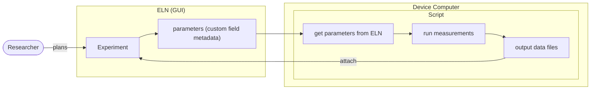

:::::::::::::::::::::::::::::::::::::: questions

- How can I retrieve experiment data with Python?
- How can I access specific information within an experiment once I have retrieved it?
- How can I upload files to eLabFTW with Python?
- How can I start creating Python scripts for automated workflows between a local device and eLabFTW?

::::::::::::::::::::::::::::::::::::::::::::::::

::::::::::::::::::::::::::::::::::::: objectives

- Retrieve an experiment from eLabFTW using Python
- Access specific pieces of data from the information returned by the API
- Perform bulk actions such as patching or uploading files to multiple experiments at once.

::::::::::::::::::::::::::::::::::::::::::::::::

## Getting Experiment Parameters from eLabFTW

In the previous episodes, we created an experiment, linked a resource, and showed how to retrieve ELN entries. Now, we will look at how to work with information from entries in eLabFTW.

Here's an overview of the intended workflow:



To this end, head to our eLabFTW test instance via your in your browser. Create at least three experiments using the Heating Test template. Enter a different Laser Power value for each in the extra fields metadata. _Note: You may change the title, just ensure the word 'Heating' remains._

The configured client, which we worked with in the previous episode, loads the API host and token from the `secrets.env` or `.env` file beside `client.py`. Don't forget to keep the token in the environment and do not place it in notebook cells or output - this is not as important if you are working on your personal computer, but is good to practice.

With the experiments planned via the GUI, we now need to retrieve the parameters. To do so, we first retrieve the experiments, then we extract the information we need.

Again, since we are using a new notebook we import everything we need:

```python
import elabapi_python
from scripts.client import api_client
```

Note: run `%pip install elabapi_python` (or for any other packages) if needed.

If we check the eLabFTW GUI for our own experiments, we will see our experiments with the category 'MEASUREMENT' with 'Heating' in the title:


First, let's get the experiments. To do so, we need the experiments api again. We also need a method to attach files. We can what that looks like by checking out the [examples/03-experiment-file-handling.py](https://github.com/elabftw/elabapi-python/blob/master/examples/03-experiment-file-handling.py) in the github repository.

We know we need the experiments API, let's create it:
```python
experiments_api = elabapi_python.ExperimentsApi(api_client)
uploads_api = elabapi_python.UploadsApi(api_client) 
```

We could get all experiments, as we just saw in the previous episode, which would work fine for our little team, but is not really efficient in reality. Luckily, the API allows us to query and this filter what it returns.

A quick check of the [HTML eLabFTW API Docs for **readExperiments**](https://doc.elabftw.net/api/elabapi-html/#api-Experiments-readExperiments) gives us information here. You can query terms, look for experiments linked to specific other entries, and so on. We have a few options here, but let's keep ot simple and look for experiments with status 'Planning' and 'Heat' in the title. We can get the status ID through the browser UI by filtering by the status and checking the address bar. We are also going to set the scope to only find our own experiments. From the docs we can see: _1: self, 2: team, 3: everything. It defaults to the user value stored in preferences._ This ensures everyone is working with their own experiments.

```python
heating_experiments=experiments_api.read_experiments(q='Heating', status=80, scope=1)
```

The return is a `list` of experiment objects. We can check how many it returned for a quick sanity check:

```python
len(heating_experiments)
````

**Output:**

```
3
```

Note: if you created more, you list will be longer.

We can also looks at the returned data:

```python
heating_experiments
````

**Output:**

```
[{'_date': '2026-10-30',
  'access_key': None,
  'body': None,
  'body_html': None,
  'canread': '{"teams": [], "users": [], "teamgroups": []}',
  'canwrite': '{"teams": [], "users": [], "teamgroups": []}',
  'category': 28,
  'category_color': 'bc0445',
  'category_title': 'Measurement',
  'comments': None,
  'compounds': None,
  'content_type': None,
  'created_at': '2026-10-30 10:11:57',
  'custom_id': None,
  'elabid': None,
  'exclusive_edit_mode': None,
  'experiments_links': None,
  'firstname': 'Nicole',
  'fullname': 'Nicole Parks',
  'has_attachment': None,
  'id': 128,
  'items_links': None,
  'lastchangeby': None,
  'lastname': 'Parks',
  'locked': 0,
  'locked_at': None,
  'lockedby': None,
  'metadata': None,
  'modified_at': '2026-10-30 13:05:48',
  'next_step': None,
  'orcid': None,
  'page': None,
  'rating': 0,
  'recent_comment': None,
  'related_experiments_links': None,
  'related_items_links': None,
  'sharelink': None,
  'state': 1,
  'status': 80,
  'status_color': '23135c',
  'status_title': 'Planning',
  'steps': None,
  'tags': None,
  'tags_id': '340,349',
  'team': 12,
  'template': -1,
  'timestamped': 0,
  'timestamped_at': None,
  'timestampedby': None,
  'title': 'Heating Test Run III',
  'type': None,
  'up_item_id': None,
  'uploads': None,
  'userid': 1},
 {'_date': '2026-10-30',
  'access_key': None,
  'body': None,
  'body_html': None,
  'canread': '{"teams": [], "users": [], "teamgroups": []}',
  'canwrite': '{"teams": [], "users": [], "teamgroups": []}',
  'category': 28,
  'category_color': 'bc0445',
  'category_title': 'Measurement',
  'comments': None,
  'compounds': None,
  'content_type': None,
  'created_at': '2026-10-30 10:09:19',
  'custom_id': None,
  'elabid': None,
  'exclusive_edit_mode': None,
  'experiments_links': None,
  'firstname': 'Nicole',
  'fullname': 'Nicole Parks',
  'has_attachment': None,
  'id': 127,
  'items_links': None,
  'lastchangeby': None,
  'lastname': 'Parks',
  'locked': 0,
  'locked_at': None,
  'lockedby': None,
  'metadata': None,
  'modified_at': '2026-10-30 13:05:48',
  'next_step': None,
  'orcid': None,
  'page': None,
  'rating': 0,
  'recent_comment': None,
  'related_experiments_links': None,
  'related_items_links': None,
  'sharelink': None,
  'state': 1,
  'status': 80,
  'status_color': '23135c',
  'status_title': 'Planning',
  'steps': None,
  'tags': None,
  'tags_id': '340,349',
  'team': 12,
  'template': -1,
  'timestamped': 0,
  'timestamped_at': None,
  'timestampedby': None,
  'title': 'Heating Test Run II',
  'type': None,
  'up_item_id': None,
  'uploads': None,
  'userid': 1},
 {'_date': '2026-10-30',
  'access_key': None,
  'body': None,
  'body_html': None,
  'canread': '{"teams": [], "users": [], "teamgroups": []}',
  'canwrite': '{"teams": [], "users": [], "teamgroups": []}',
  'category': 28,
  'category_color': 'bc0445',
  'category_title': 'Measurement',
  'comments': None,
  'compounds': None,
  'content_type': None,
  'created_at': '2026-10-30 09:55:43',
  'custom_id': None,
  'elabid': None,
  'exclusive_edit_mode': None,
  'experiments_links': None,
  'firstname': 'Nicole',
  'fullname': 'Nicole Parks',
  'has_attachment': None,
  'id': 126,
  'items_links': None,
  'lastchangeby': None,
  'lastname': 'Parks',
  'locked': 0,
  'locked_at': None,
  'lockedby': None,
  'metadata': None,
  'modified_at': '2026-10-30 13:05:25',
  'next_step': None,
  'orcid': None,
  'page': None,
  'rating': 0,
  'recent_comment': None,
  'related_experiments_links': None,
  'related_items_links': None,
  'sharelink': None,
  'state': 1,
  'status': 80,
  'status_color': '23135c',
  'status_title': 'Planning',
  'steps': None,
  'tags': None,
  'tags_id': '340,349',
  'team': 12,
  'template': -1,
  'timestamped': 0,
  'timestamped_at': None,
  'timestampedby': None,
  'title': 'Heating Test Run I',
  'type': None,
  'up_item_id': None,
  'uploads': None,
  'userid': 1}]
```

We can access individual pieces of information from each of the returned experiments, which are elabapi-python objects. Let's look at a single one and extract some information (remember how we can use indexing for lists, as shown in [our crash course in episode 03](03_python_jupyter.md#3-lists-ordered-collections)):

```python
my_experiment = heating_experiments[0]
print(my_experiment.title)
print(my_experiment.created_at)
print(f"Experiment owned by: {my_experiment.fullname}")
```

**Output:**

```
Heating Test Run I
2026-10-30 09:55:43
Experiment owned by: Nicole Parks
```

This is what we expect if we look at the same experiment in the GUI:


::::::::::::::::::::::::::::::::::::: challenge

How would you access the ID for each of the experiments you retrieved using the GUI?

Bonus: How can you avoid having to access the experiment by its individual index each time you want to retrieve the ID?

:::::::: hint
For bonus: Check out the [previous episode on iteration](03_python_jupyter.md#4-loop-over-a-list-forloop-to-create-a-dictionary)

:::::::::::::


::::::::::::::::::::::::::::::::::::: solution

You can use the same syntax as above to retrieve a an ID from a single experiment.

```python
heating_experiments[0].id
```

We could then write

```python
print(heating_experiments[0].id)
print(heating_experiments[1].id)
print(heating_experiments[2].id)
```

to print each id.

To avoid having to access each individual one, we can use a for loop:

```python
for experiment in heating_experiments:
  print(experiment.id)
```

:::::::::::::::::::::::::::::::::::::::::::::::
:::::::::::::::::::::::::::::::::::::::::::::::::::::::::::::::
What we need to run our experiments is the laser power entry. There's a slight bug in the Python package as you may notice: the parameters, which would be in `metadata` are missing:

```python
print(my_experiment.metadata)
```

**Output:**

```
None
```

[This issue has been reported](https://github.com/elabftw/elabapi-python/issues/35), but it has not been fixed, yet.

The code for iterating over the experiments and pulling it out would be:

```python
power_settings = []
for exp in heating_experiments:
    power_setting = exp.metadata.extra_fields["Laser Power"]
    power_settings.append(power_setting)
```

There's many ways to get what we need: here, we will use the `requests` package to make the API request directly and get the full experiment information. The returned data structure is a bit different, but that's fine.

```python
%pip install requests
from scripts.client import API_HOST, API_KEY
import requests

heating_experiments_full = []

for exp in heating_experiments:
    exp_id = exp.id
    endpoint = API_HOST + f'/experiments/{exp_id}'
    headers = {'Authorization': f'{API_KEY}'}
    response = requests.get(endpoint, headers=headers)
    heating_experiments_full.append(response.json())
```

Generally, it's good to know you have a lot of options to get where you need to be. Another possible workaround may have been, for example, to download the experiment as a JSON or ELN Format file and pull the info from there.

Now that we have our experiments, we can pull out the information we need. Again, we've saved the experiments as a list. In this case they are now a list of Python _dictionaries_ instead of _elabapi-python objects_. We access the information a little differently. Let's look at a single experiment, accessing it by its index:

```python
heating_experiments_full[0]
```

```
[{'access_key': None,
  'body': '<p style="line-height:1;"><strong>Goal</strong>: Gain an understanding of salt water temperature behavior when heated with a "super laser". This will inidicate how to scale this experiment and threaten the world powers to bend to my every demand!</p>\n<p>The switch-off temperature is set to 100 by default (see fields below).\xa0</p>',
  'body_html': '<p style="line-height:1;"><strong>Goal</strong>: Gain an understanding of salt water temperature behavior when heated with a "super laser". This will inidicate how to scale this experiment and threaten the world powers to bend to my every demand!</p>\n<p>The switch-off temperature is set to 100 by default (see fields below).\xa0</p>',
  'canread': '{"teams": [], "users": [], "teamgroups": []}',
  'canread_base': 30,
  'canread_base_human': 'Only members of the team',
  'canread_is_immutable': 0,
  'canwrite': '{"teams": [], "users": [], "teamgroups": []}',
  'canwrite_base': 20,
  'canwrite_base_human': 'Only owner and admins',
  'canwrite_is_immutable': 0,
  'category': 28,
  'category_color': 'bc0445',
  'category_title': 'Measurement',
  'changelog': [{'created_at': '2026-10-30 13:05:48',
    'target': 'status',
    'content': '80',
    'fullname': 'Nicole Parks',
    'userid': 1},
   {'created_at': '2026-10-30 10:12:11',
    'target': 'metadata_Laser Power',
    'content': '125',
    'fullname': 'Nicole Parks',
    'userid': 1},
   {'created_at': '2026-10-30 10:12:03',
    'target': 'title',
    'content': 'Heating Test Run III',
    'fullname': 'Nicole Parks',
    'userid': 1},
   {'created_at': '2026-10-30 10:11:57',
    'target': 'created',
    'content': 'Experiment was created from <a href="experiments.php?mode=view&amp;id=127">Experiment #127</a>',
    'fullname': 'Nicole Parks',
    'userid': 1},
   {'created_at': '2026-10-30 10:11:57',
    'target': 'tags',
    'content': 'Added tag "evil plan" with id: 340',
    'fullname': 'Nicole Parks',
    'userid': 1},
   {'created_at': '2026-10-30 10:11:57',
    'target': 'tags',
    'content': 'Added tag "miniature scale" with id: 349',
    'fullname': 'Nicole Parks',
    'userid': 1}],
  'comments': [],
  'compounds_links': [],
  'containers': [],
  'content_type': 1,
  'created_at': '2026-10-30 10:11:57',
  'created_from_id': 127,
  'created_from_type': 1,
  'created_from_type_human': 'experiment',
  'custom_id': None,
  'date': '2026-10-30',
  'elabid': '20261030-6bfdf255705718466183dde7c679bd7b782894e6',
  'events_start': None,
  'events_start_itemid': None,
  'exclusive_edit_mode': None,
  'experiments_links': [],
  'firstname': 'Nicole',
  'fullname': 'Nicole Parks',
  'hide_main_text': 0,
  'id': 128,
  'is_pinned': 0,
  'items_links': [{'entityid': 144,
    'title': 'Bluetooth Infrared Thermometer',
    'custom_id': None,
    'elabid': '20261020-d7ce38b251063e8904c615d74b35a2f6df9c2b2c',
    'link_state': 1,
    'is_bookable': 0,
    'page': 'database.php',
    'type': 'items',
    'category_id': 5,
    'category_title': '🔬Device',
    'category_color': 'f1af40',
    'status_id': None,
    'status_title': None,
    'status_color': None},
   {'entityid': 145,
    'title': 'Super Laser 2000 Mini',
    'custom_id': None,
    'elabid': '20261020-5c1b56e448e6a6ce88a7a3477236e6e2fbff6ee0',
    'link_state': 1,
    'is_bookable': 0,
    'page': 'database.php',
    'type': 'items',
    'category_id': 5,
    'category_title': '🔬Device',
    'category_color': 'f1af40',
    'status_id': None,
    'status_title': None,
    'status_color': None},
   {'entityid': 150,
    'title': 'Magnetic Stirbar (medium)',
    'custom_id': None,
    'elabid': '20261020-b0f1832f1ade1a572b44f307b65cc7ed1969cedf',
    'link_state': 1,
    'is_bookable': 0,
    'page': 'database.php',
    'type': 'items',
    'category_id': 44,
    'category_title': 'Equipment',
    'category_color': '503cb9',
    'status_id': None,
    'status_title': None,
    'status_color': None},
   {'entityid': 149,
    'title': 'Magnetic stirrer',
    'custom_id': None,
    'elabid': '20261020-758fc1098b020ca999de04b6693dd03791d7bd24',
    'link_state': 1,
    'is_bookable': 0,
    'page': 'database.php',
    'type': 'items',
    'category_id': 44,
    'category_title': 'Equipment',
    'category_color': '503cb9',
    'status_id': None,
    'status_title': None,
    'status_color': None},
   {'entityid': 147,
    'title': 'Beaker 500 ml',
    'custom_id': None,
    'elabid': '20261020-23d11e08cc207c83dead83a4be51f24839a366ae',
    'link_state': 1,
    'is_bookable': 0,
    'page': 'database.php',
    'type': 'items',
    'category_id': 41,
    'category_title': 'Glassware',
    'category_color': '75d5ff',
    'status_id': None,
    'status_title': None,
    'status_color': None},
   {'entityid': 146,
    'title': 'Polycarbonate Safety Chamber',
    'custom_id': None,
    'elabid': '20261020-9f6fe5fb55cf02e56ce7e9198cc44d561cfc057d',
    'link_state': 1,
    'is_bookable': 0,
    'page': 'database.php',
    'type': 'items',
    'category_id': 40,
    'category_title': 'PPE',
    'category_color': 'f3312f',
    'status_id': None,
    'status_title': None,
    'status_color': None},
   {'entityid': 148,
    'title': 'Salterwater 3.5%',
    'custom_id': None,
    'elabid': '20261020-6e1a3e6fba5070542baae447b54d23848390d39a',
    'link_state': 1,
    'is_bookable': 0,
    'page': 'database.php',
    'type': 'items',
    'category_id': 43,
    'category_title': 'Stock Solution',
    'category_color': 'a65d28',
    'status_id': None,
    'status_title': None,
    'status_color': None}],
  'last_signed_at': None,
  'last_signed_by': None,
  'lastchangeby': 1,
  'lastname': 'Parks',
  'locked': 0,
  'locked_at': None,
  'lockedby': None,
  'metadata': '{"extra_fields": {"Laser Power": {"type": "number", "unit": "W", "units": ["W"], "value": "125"}, "Switch-off Temperature": {"type": "number", "unit": "°C", "units": ["°C", "K"], "value": "100"}}}',
  'metadata_decoded': {'extra_fields': {'Laser Power': {'type': 'number',
     'unit': 'W',
     'units': ['W'],
     'value': '125'},
    'Switch-off Temperature': {'type': 'number',
     'unit': '°C',
     'units': ['°C', 'K'],
     'value': '100'}}},
  'modified_at': '2026-10-30 13:05:48',
  'next_step': None,
  'orcid': None,
  'page': 'experiments',
  'rating': 0,
  'recent_comment': None,
  'related_experiments_links': [],
  'related_items_links': [],
  'sharelink': 'https://elab.parks.web.gateway.ionos.coscine.dev/experiments.php?mode=view&id=128',
  'signature_count': 0,
  'state': 1,
  'status': 80,
  'status_color': '23135c',
  'status_title': 'Planning',
  'steps': [],
  'surrounding_bookers': [],
  'tags': 'evil plan|miniature scale',
  'tags_decoded': [{'id': 340, 'tag': 'evil plan', 'is_favorite': False},
   {'id': 349, 'tag': 'miniature scale', 'is_favorite': False}],
  'tags_id': '340,349',
  'team': 12,
  'team_name': 'FDMIII-API_2026_11',
  'timestamped': 0,
  'timestamped_at': None,
  'timestampedby': None,
  'title': 'Heating Test Run III',
  'type': 'experiments',
  'uploads': [],
  'userid': 1},
 {'access_key': None,
  'body': '<p style="line-height:1;"><strong>Goal</strong>: Gain an understanding of salt water temperature behavior when heated with a "super laser". This will inidicate how to scale this experiment and threaten the world powers to bend to my every demand!</p>\n<p>The switch-off temperature is set to 100 by default (see fields below).\xa0</p>',
  'body_html': '<p style="line-height:1;"><strong>Goal</strong>: Gain an understanding of salt water temperature behavior when heated with a "super laser". This will inidicate how to scale this experiment and threaten the world powers to bend to my every demand!</p>\n<p>The switch-off temperature is set to 100 by default (see fields below).\xa0</p>',
  'canread': '{"teams": [], "users": [], "teamgroups": []}',
  'canread_base': 30,
  'canread_base_human': 'Only members of the team',
  'canread_is_immutable': 0,
  'canwrite': '{"teams": [], "users": [], "teamgroups": []}',
  'canwrite_base': 20,
  'canwrite_base_human': 'Only owner and admins',
  'canwrite_is_immutable': 0,
  'category': 28,
  'category_color': 'bc0445',
  'category_title': 'Measurement',
  'changelog': [{'created_at': '2026-10-30 13:05:48',
    'target': 'status',
    'content': '80',
    'fullname': 'Nicole Parks',
    'userid': 1},
   {'created_at': '2026-10-30 10:12:21',
    'target': 'title',
    'content': 'Heating Test Run II',
    'fullname': 'Nicole Parks',
    'userid': 1},
   {'created_at': '2026-10-30 10:11:52',
    'target': 'body',
    'content': 'Depending on your instance configuration, the change in the body is possibly recorded in the revisions. <a href="revisions.php?type=experiments&amp;item_id=127">See revisions page.</a>',
    'fullname': 'Nicole Parks',
    'userid': 1},
   {'created_at': '2026-10-30 10:11:49',
    'target': 'links',
    'content': 'Removed link to experiment: <a href="/experiments.php?mode=view&amp;id=126">Heating Test Run I</a>',
    'fullname': 'Nicole Parks',
    'userid': 1},
   {'created_at': '2026-10-30 10:11:35',
    'target': 'metadata_Laser Power',
    'content': '100',
    'fullname': 'Nicole Parks',
    'userid': 1},
   {'created_at': '2026-10-30 10:11:30',
    'target': 'body',
    'content': 'Depending on your instance configuration, the change in the body is possibly recorded in the revisions. <a href="revisions.php?type=experiments&amp;item_id=127">See revisions page.</a>',
    'fullname': 'Nicole Parks',
    'userid': 1},
   {'created_at': '2026-10-30 10:09:19',
    'target': 'created',
    'content': 'Experiment was created from <a href="experiments.php?mode=view&amp;id=126">Experiment #126</a>',
    'fullname': 'Nicole Parks',
    'userid': 1},
   {'created_at': '2026-10-30 10:09:19',
    'target': 'tags',
    'content': 'Added tag "evil plan" with id: 340',
    'fullname': 'Nicole Parks',
    'userid': 1},
   {'created_at': '2026-10-30 10:09:19',
    'target': 'tags',
    'content': 'Added tag "miniature scale" with id: 349',
    'fullname': 'Nicole Parks',
    'userid': 1},
   {'created_at': '2026-10-30 10:09:19',
    'target': 'links',
    'content': 'Added link to experiment: <a href="/experiments.php?mode=view&amp;id=126">Heating Test Run I</a>',
    'fullname': 'Nicole Parks',
    'userid': 1}],
  'comments': [],
  'compounds_links': [],
  'containers': [],
  'content_type': 1,
  'created_at': '2026-10-30 10:09:19',
  'created_from_id': 126,
  'created_from_type': 1,
  'created_from_type_human': 'experiment',
  'custom_id': None,
  'date': '2026-10-30',
  'elabid': '20261030-83e2255949f2ef06e77b8120a7a623ac1a6b30e1',
  'events_start': None,
  'events_start_itemid': None,
  'exclusive_edit_mode': None,
  'experiments_links': [],
  'firstname': 'Nicole',
  'fullname': 'Nicole Parks',
  'hide_main_text': 0,
  'id': 127,
  'is_pinned': 0,
  'items_links': [{'entityid': 144,
    'title': 'Bluetooth Infrared Thermometer',
    'custom_id': None,
    'elabid': '20261020-d7ce38b251063e8904c615d74b35a2f6df9c2b2c',
    'link_state': 1,
    'is_bookable': 0,
    'page': 'database.php',
    'type': 'items',
    'category_id': 5,
    'category_title': '🔬Device',
    'category_color': 'f1af40',
    'status_id': None,
    'status_title': None,
    'status_color': None},
   {'entityid': 145,
    'title': 'Super Laser 2000 Mini',
    'custom_id': None,
    'elabid': '20261020-5c1b56e448e6a6ce88a7a3477236e6e2fbff6ee0',
    'link_state': 1,
    'is_bookable': 0,
    'page': 'database.php',
    'type': 'items',
    'category_id': 5,
    'category_title': '🔬Device',
    'category_color': 'f1af40',
    'status_id': None,
    'status_title': None,
    'status_color': None},
   {'entityid': 150,
    'title': 'Magnetic Stirbar (medium)',
    'custom_id': None,
    'elabid': '20261020-b0f1832f1ade1a572b44f307b65cc7ed1969cedf',
    'link_state': 1,
    'is_bookable': 0,
    'page': 'database.php',
    'type': 'items',
    'category_id': 44,
    'category_title': 'Equipment',
    'category_color': '503cb9',
    'status_id': None,
    'status_title': None,
    'status_color': None},
   {'entityid': 149,
    'title': 'Magnetic stirrer',
    'custom_id': None,
    'elabid': '20261020-758fc1098b020ca999de04b6693dd03791d7bd24',
    'link_state': 1,
    'is_bookable': 0,
    'page': 'database.php',
    'type': 'items',
    'category_id': 44,
    'category_title': 'Equipment',
    'category_color': '503cb9',
    'status_id': None,
    'status_title': None,
    'status_color': None},
   {'entityid': 147,
    'title': 'Beaker 500 ml',
    'custom_id': None,
    'elabid': '20261020-23d11e08cc207c83dead83a4be51f24839a366ae',
    'link_state': 1,
    'is_bookable': 0,
    'page': 'database.php',
    'type': 'items',
    'category_id': 41,
    'category_title': 'Glassware',
    'category_color': '75d5ff',
    'status_id': None,
    'status_title': None,
    'status_color': None},
   {'entityid': 146,
    'title': 'Polycarbonate Safety Chamber',
    'custom_id': None,
    'elabid': '20261020-9f6fe5fb55cf02e56ce7e9198cc44d561cfc057d',
    'link_state': 1,
    'is_bookable': 0,
    'page': 'database.php',
    'type': 'items',
    'category_id': 40,
    'category_title': 'PPE',
    'category_color': 'f3312f',
    'status_id': None,
    'status_title': None,
    'status_color': None},
   {'entityid': 148,
    'title': 'Salterwater 3.5%',
    'custom_id': None,
    'elabid': '20261020-6e1a3e6fba5070542baae447b54d23848390d39a',
    'link_state': 1,
    'is_bookable': 0,
    'page': 'database.php',
    'type': 'items',
    'category_id': 43,
    'category_title': 'Stock Solution',
    'category_color': 'a65d28',
    'status_id': None,
    'status_title': None,
    'status_color': None}],
  'last_signed_at': None,
  'last_signed_by': None,
  'lastchangeby': 1,
  'lastname': 'Parks',
  'locked': 0,
  'locked_at': None,
  'lockedby': None,
  'metadata': '{"extra_fields": {"Laser Power": {"type": "number", "unit": "W", "units": ["W"], "value": "100"}, "Switch-off Temperature": {"type": "number", "unit": "°C", "units": ["°C", "K"], "value": "100"}}}',
  'metadata_decoded': {'extra_fields': {'Laser Power': {'type': 'number',
     'unit': 'W',
     'units': ['W'],
     'value': '100'},
    'Switch-off Temperature': {'type': 'number',
     'unit': '°C',
     'units': ['°C', 'K'],
     'value': '100'}}},
  'modified_at': '2026-10-30 13:05:48',
  'next_step': None,
  'orcid': None,
  'page': 'experiments',
  'rating': 0,
  'recent_comment': None,
  'related_experiments_links': [],
  'related_items_links': [],
  'sharelink': 'https://elab.parks.web.gateway.ionos.coscine.dev/experiments.php?mode=view&id=127',
  'signature_count': 0,
  'state': 1,
  'status': 80,
  'status_color': '23135c',
  'status_title': 'Planning',
  'steps': [],
  'surrounding_bookers': [],
  'tags': 'evil plan|miniature scale',
  'tags_decoded': [{'id': 340, 'tag': 'evil plan', 'is_favorite': False},
   {'id': 349, 'tag': 'miniature scale', 'is_favorite': False}],
  'tags_id': '340,349',
  'team': 12,
  'team_name': 'FDMIII-API_2026_11',
  'timestamped': 0,
  'timestamped_at': None,
  'timestampedby': None,
  'title': 'Heating Test Run II',
  'type': 'experiments',
  'uploads': [],
  'userid': 1},
 {'access_key': None,
  'body': '<p style="line-height:1;"><strong>Goal</strong>: Gain an understanding of salt water temperature behavior when heated with a "super laser". This will inidicate how to scale this experiment and threaten the world powers to bend to my every demand!</p>\n<p>The switch-off temperature is set to 100 by default (see fields below).\xa0</p>',
  'body_html': '<p style="line-height:1;"><strong>Goal</strong>: Gain an understanding of salt water temperature behavior when heated with a "super laser". This will inidicate how to scale this experiment and threaten the world powers to bend to my every demand!</p>\n<p>The switch-off temperature is set to 100 by default (see fields below).\xa0</p>',
  'canread': '{"teams": [], "users": [], "teamgroups": []}',
  'canread_base': 30,
  'canread_base_human': 'Only members of the team',
  'canread_is_immutable': 0,
  'canwrite': '{"teams": [], "users": [], "teamgroups": []}',
  'canwrite_base': 20,
  'canwrite_base_human': 'Only owner and admins',
  'canwrite_is_immutable': 0,
  'category': 28,
  'category_color': 'bc0445',
  'category_title': 'Measurement',
  'changelog': [{'created_at': '2026-10-30 13:05:48',
    'target': 'status',
    'content': '80',
    'fullname': 'Nicole Parks',
    'userid': 1},
   {'created_at': '2026-10-30 13:05:25',
    'target': 'status',
    'content': '80',
    'fullname': 'Nicole Parks',
    'userid': 1},
   {'created_at': '2026-10-30 13:04:36',
    'target': 'status',
    'content': '47',
    'fullname': 'Nicole Parks',
    'userid': 1},
   {'created_at': '2026-10-30 10:12:38',
    'target': 'body',
    'content': 'Depending on your instance configuration, the change in the body is possibly recorded in the revisions. <a href="revisions.php?type=experiments&amp;item_id=126">See revisions page.</a>',
    'fullname': 'Nicole Parks',
    'userid': 1},
   {'created_at': '2026-10-30 10:09:07',
    'target': 'title',
    'content': 'Heating Test Run I',
    'fullname': 'Nicole Parks',
    'userid': 1},
   {'created_at': '2026-10-30 10:09:01',
    'target': 'title',
    'content': 'Heating Test run I',
    'fullname': 'Nicole Parks',
    'userid': 1},
   {'created_at': '2026-10-30 10:08:35',
    'target': 'metadata_Laser Power',
    'content': '50',
    'fullname': 'Nicole Parks',
    'userid': 1},
   {'created_at': '2026-10-30 09:55:43',
    'target': 'created',
    'content': 'Experiment was created from <a href="templates.php?mode=view&amp;id=32">Experiment template #32</a>',
    'fullname': 'Nicole Parks',
    'userid': 1},
   {'created_at': '2026-10-30 09:55:43',
    'target': 'tags',
    'content': 'Added tag "evil plan" with id: 340',
    'fullname': 'Nicole Parks',
    'userid': 1},
   {'created_at': '2026-10-30 09:55:43',
    'target': 'tags',
    'content': 'Added tag "miniature scale" with id: 349',
    'fullname': 'Nicole Parks',
    'userid': 1}],
  'comments': [],
  'compounds_links': [],
  'containers': [],
  'content_type': 1,
  'created_at': '2026-10-30 09:55:43',
  'created_from_id': 32,
  'created_from_type': 3,
  'created_from_type_human': 'experiment template',
  'custom_id': None,
  'date': '2026-10-30',
  'elabid': '20261030-8fcae3ad5c21fa161382c8a181693d92c50d1921',
  'events_start': None,
  'events_start_itemid': None,
  'exclusive_edit_mode': None,
  'experiments_links': [],
  'firstname': 'Nicole',
  'fullname': 'Nicole Parks',
  'hide_main_text': 0,
  'id': 126,
  'is_pinned': 0,
  'items_links': [{'entityid': 144,
    'title': 'Bluetooth Infrared Thermometer',
    'custom_id': None,
    'elabid': '20261020-d7ce38b251063e8904c615d74b35a2f6df9c2b2c',
    'link_state': 1,
    'is_bookable': 0,
    'page': 'database.php',
    'type': 'items',
    'category_id': 5,
    'category_title': '🔬Device',
    'category_color': 'f1af40',
    'status_id': None,
    'status_title': None,
    'status_color': None},
   {'entityid': 145,
    'title': 'Super Laser 2000 Mini',
    'custom_id': None,
    'elabid': '20261020-5c1b56e448e6a6ce88a7a3477236e6e2fbff6ee0',
    'link_state': 1,
    'is_bookable': 0,
    'page': 'database.php',
    'type': 'items',
    'category_id': 5,
    'category_title': '🔬Device',
    'category_color': 'f1af40',
    'status_id': None,
    'status_title': None,
    'status_color': None},
   {'entityid': 150,
    'title': 'Magnetic Stirbar (medium)',
    'custom_id': None,
    'elabid': '20261020-b0f1832f1ade1a572b44f307b65cc7ed1969cedf',
    'link_state': 1,
    'is_bookable': 0,
    'page': 'database.php',
    'type': 'items',
    'category_id': 44,
    'category_title': 'Equipment',
    'category_color': '503cb9',
    'status_id': None,
    'status_title': None,
    'status_color': None},
   {'entityid': 149,
    'title': 'Magnetic stirrer',
    'custom_id': None,
    'elabid': '20261020-758fc1098b020ca999de04b6693dd03791d7bd24',
    'link_state': 1,
    'is_bookable': 0,
    'page': 'database.php',
    'type': 'items',
    'category_id': 44,
    'category_title': 'Equipment',
    'category_color': '503cb9',
    'status_id': None,
    'status_title': None,
    'status_color': None},
   {'entityid': 147,
    'title': 'Beaker 500 ml',
    'custom_id': None,
    'elabid': '20261020-23d11e08cc207c83dead83a4be51f24839a366ae',
    'link_state': 1,
    'is_bookable': 0,
    'page': 'database.php',
    'type': 'items',
    'category_id': 41,
    'category_title': 'Glassware',
    'category_color': '75d5ff',
    'status_id': None,
    'status_title': None,
    'status_color': None},
   {'entityid': 146,
    'title': 'Polycarbonate Safety Chamber',
    'custom_id': None,
    'elabid': '20261020-9f6fe5fb55cf02e56ce7e9198cc44d561cfc057d',
    'link_state': 1,
    'is_bookable': 0,
    'page': 'database.php',
    'type': 'items',
    'category_id': 40,
    'category_title': 'PPE',
    'category_color': 'f3312f',
    'status_id': None,
    'status_title': None,
    'status_color': None},
   {'entityid': 148,
    'title': 'Salterwater 3.5%',
    'custom_id': None,
    'elabid': '20261020-6e1a3e6fba5070542baae447b54d23848390d39a',
    'link_state': 1,
    'is_bookable': 0,
    'page': 'database.php',
    'type': 'items',
    'category_id': 43,
    'category_title': 'Stock Solution',
    'category_color': 'a65d28',
    'status_id': None,
    'status_title': None,
    'status_color': None}],
  'last_signed_at': None,
  'last_signed_by': None,
  'lastchangeby': 1,
  'lastname': 'Parks',
  'locked': 0,
  'locked_at': None,
  'lockedby': None,
  'metadata': '{"extra_fields": {"Laser Power": {"type": "number", "unit": "W", "units": ["W"], "value": "50"}, "Switch-off Temperature": {"type": "number", "unit": "°C", "units": ["°C", "K"], "value": "100"}}}',
  'metadata_decoded': {'extra_fields': {'Laser Power': {'type': 'number',
     'unit': 'W',
     'units': ['W'],
     'value': '50'},
    'Switch-off Temperature': {'type': 'number',
     'unit': '°C',
     'units': ['°C', 'K'],
     'value': '100'}}},
  'modified_at': '2026-10-30 13:05:25',
  'next_step': None,
  'orcid': None,
  'page': 'experiments',
  'rating': 0,
  'recent_comment': None,
  'related_experiments_links': [],
  'related_items_links': [],
  'sharelink': 'https://elab.parks.web.gateway.ionos.coscine.dev/experiments.php?mode=view&id=126',
  'signature_count': 0,
  'state': 1,
  'status': 80,
  'status_color': '23135c',
  'status_title': 'Planning',
  'steps': [],
  'surrounding_bookers': [],
  'tags': 'evil plan|miniature scale',
  'tags_decoded': [{'id': 340, 'tag': 'evil plan', 'is_favorite': False},
   {'id': 349, 'tag': 'miniature scale', 'is_favorite': False}],
  'tags_id': '340,349',
  'team': 12,
  'team_name': 'FDMIII-API_2026_11',
  'timestamped': 0,
  'timestamped_at': None,
  'timestampedby': None,
  'title': 'Heating Test Run I',
  'type': 'experiments',
  'uploads': [],
  'userid': 1}]
```

Again we see all the information we would expect–and then some. Keeping our eyes out for the work _metadata_ we see:

```
'metadata': '{"extra_fields": {"Laser Power": {"type": "number", "unit": "W", "units": ["W"], "value": "50"}, "Switch-off Temperature": {"type": "number", "unit": "°C", "units": ["°C", "K"], "value": "100"}}}',
'metadata_decoded': {'extra_fields': {'Laser Power': {'type': 'number',
    'unit': 'W',
    'units': ['W'],
    'value': '50'},
  'Switch-off Temperature': {'type': 'number',
    'unit': '°C',
    'units': ['°C', 'K'],
    'value': '100'}}},
```

Corresponding to the custom fields in our experiment:


There is a `metadata` and a `metadata_decoded`. We can quickly check what te differences are by using Python's built-in `type()` function.  Note, values are accessed slightly differently in dictionaries than in elabapi-python objects:

```python
type(heating_experiments_full[0]['metadata'])
```

**Output:**

```
str
````

```python
type(heating_experiments_full[0]['metadata_decoded'])
```

**Output:**

```
dict
```

Basically, `metadata_decoded` means the json-formatted string has already been decoded into a dictionary, which is easy to use in Python. This is what we need.

Let's output that part so we know how to access the values needed:

```python
heating_experiments_full[0]['metadata_decoded']
```

**Output:**

```
{'extra_fields': {'Laser Power': {'type': 'number',
   'unit': 'W',
   'units': ['W'],
   'value': '125'},
  'Switch-off Temperature': {'type': 'number',
   'unit': '°C',
   'units': ['°C', 'K'],
   'value': '100'}}}
```

That means we can access each value accordingly:

```python
heating_experiments_full[0]['metadata_decoded']['extra_fields']['Laser Power']['value']
```

**Output:**

```
'125'
```

We want to use hese in a pre-prepared script that contains a function that generates some synthetic data and saves it as a CSV (see `scripts/generate_measurement.py`). Let's import this and run it for each experiment, e.g., every set of values. The function returns the path to the generated file, which we will save in a list so we can easily access each one in later steps.

```python
from scripts.generate_measurement import generate_measurement

measurement_files = []

for exp in heating_experiments_full:
    off_temp = exp['metadata_decoded']['extra_fields']['Switch-off Temperature']['value']

    laser_power = exp['metadata_decoded']['extra_fields']['Laser Power']['value']

    print(f"Running measurement with laser poser {laser_power} and shut-off temperature {off_temp}...")

    output_path = generate_measurement(power_w = float(laser_power), break_temp=float(off_temp))

    print(f"Output file saved to {output_path}")
    measurement_files.append(output_path)

```

If you check the output folder `output_data/`, you will see three files have been created.

Let's go ahead and attach these back to the experiment. We can check [line 42-47 in examples/23-create-resources-and-upload-pdfs.py](https://github.com/elabftw/elabapi-python/blob/master/examples/23-create-resources-and-upload-pdfs.py#L42C5-L47C6) in the GitHub Python examples to see how we upload files to entries.

```python
for exp in heating_experiments_full:
    exp_id = exp['id']
    power = exp['metadata_decoded']['extra_fields']['Laser Power']['value']
    for file in measurement_files:
        if file.name.startswith(power):
            uploads_api.post_upload(
                "experiments",
                exp_id,
                file=str(file),

    )

```

If we check our experiments in the GUI, we should see your attached files:


::::::::::::::::::::::::::::::::::::: challenge

Write a for loops that sets each experiment status to running.

::::::: hint
Get an idea of what the commands could look like in the example [examples/05-create-modify-item.py](https://github.com/elabftw/elabapi-python/blob/master/examples/05-create-modify-item.py) on GitHub.
:::::::::::::

Execute the code and check the GUI to see if it worked.

::::::::::::::::::::::::::::::::::::: solution

The request we are making is a `patch` to an existing experiment. We need to tell the

```python
for exp in heating_experiments_full:
    exp_id = exp['id']
    experiments_api.patch_experiment(exp_id, body={'status': 47})

```

Note, and alternative using the original experiment return (using the elabapi-python package) would be:

```python
for exp in heating_experiments:
    exp_id = exp.id
    experiments_api.patch_experiment(exp_id, body={'status': 47})
```

Here, we are working with the eLabFTW object instead of a dictionary, so we access the experiment ID differently.

We could shorten this a bit:

```python
for exp in heating_experiments:
    experiments_api.patch_experiment(exp.id, body={'status': 47})
```

::::::::::::::::::::::::::::::::::::
:::::::::::::::::::::::::::::::::::::::::::::::

::::::::::::::::::::::::::::::::::::: callout

Showing this in a Jupyter Notebook helps you better understand the single steps. However, as you may have noticed, this is really innefficient, e.g. it loops over the experiments list and gets the power variable twice. This would all be consolidated into a script. Here, we would create single functions for each step and so on. Then this could be run automatically, e.g., on a device computer, maybe one schedule that checks for new experimets entered throug the GUI and then runs them for you and attached the output files for you to then check through the GUI.

::::::::::::::::::::::::::::::::::::::::::::::::

::::::::::::::::::::::::::::::::::::: keypoints

- Retrieve information using either the elabapi_python module or requests
- Use queries and filters in your Python API requests
- Access specific entries by given parameters in retrieved experiments
- Iterate (loop) over lists of entries to perform bulk actions

:::::::::::::::::::::::::::::::::::::::::::::::
