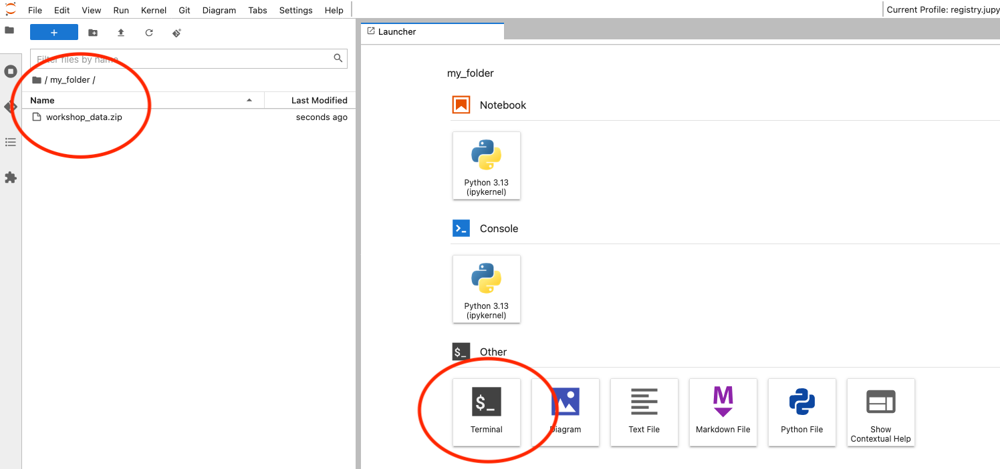
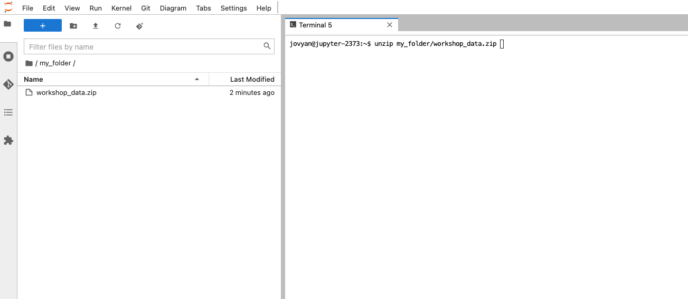

:::::::::::::::::::::::::::::::::::::::: callout

We will be in the workshop room 30 minutes prior to the workshop starting. Please come early if you have any issues with this setup!

::::::::::::::::::::::::::::::::::::::::::::::::

## Software Setup

### eLabFTW

We will use a demo instance of eLabFTW. As such, we have created a team for this workshop.

To access the demo instance and team:

1. Head to https://elab.parks.web.gateway.ionos.coscine.dev/register.php
2. Select the team `YYYY-MM-DD_FDMIII_API` (where YYYY-MM-DD is the date of the workshop)
3. Fill in your information
4. Click `Create`

An Admin will then validate you account. 

You will have access to this team for 4 weeks after the workshop. Your account will then be deleted.

### Jupyter Lab

This course borrows from the concepts of [The Carpentries](https://carpentries.org/). Thus, it contains a lot of live coding and exercises–it's hands on! That means, you will need some kind of working environment.

Everything is designed so you do not have to download and install anything locally (you can, if you like). We will use an online version of Jupyter Lab for everything we do. If you are an RWTH Aachen member, feel free to use the RWTH's Jupyter Hub. Otherwise, you may use Jupyter4NFDI.

Jupyter Lab is an environment that allows you to code in Python (or Julia, R, ...), interact with a terminal, and so on. It is an easy way to get started – and notably, to teach courses like this.

:::::::::::::::::::::: spoiler

### [RWTH JupyterHub](https://jupyter.rwth-aachen.de/hub/) (requires RWTH Account)

1. Head to https://jupyter.rwth-aachen.de/hub/login and sign in with your credentials
2. Select the `Python 3.13` profile
3. Scroll down and click `START`

Most things appear to remain saved in Jupyter Hub - but I would still recommend downloaded the content after the course if you want to ensure full access to what you did.

::::::::::::::::::::::

:::::::::::::::::::::: spoiler

### [Jupyter4NFDI](https://hub.nfdi-jupyter.de/hub/home)

1. Head to https://hub.nfdi-jupyter.de/hub/login and click `Sign in`
2. Follow the instructions to sign in
3. Accept the acceptable use policy
4. Give your new Jupyter Lab a name. The base configuration should be sufficient.
5. Click `Start`

Remember to download everything if you want to keep it after the course!

::::::::::::::::::::::

All course material (included a filled-out version of the notebook) will be available after the course via Moodle.

## Datasets

Download the zipfile [workshop-data.zip](data/workshop-data.zip). Unzip and then upload to Jupyter Lab maintaining the file structure.

Since folder drag-and-drop is not currently supported, the easiest way to do this:

1. Drag-and-drop the zip file to the file into the file explorer in to the left.
2. Open a terminal (click the blue plus button on the top left if you don't see the launcher tab)

1. Type:

```bash
unzip workshop_data.zip
```

If you have the zipfile in a folder:

```bash
unzip path/to/folder/workshop_data.zip
```



You can, of course, add each file file and manually. You can create folders in Jupyter lab by clicking the folder icon with the little `+`-sign at the top of the file explorer.


:::::::::::::::::::::::::::::::::::::::: callout

The `workshop_data` folder is also available via the Moodle room for you specific course.

::::::::::::::::::::::::::::::::::::::::::::::::
